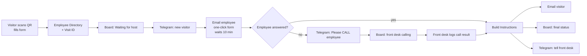

# SmartLobby — Visitor Routing Automation (n8n)

A front-desk automation that routes walk-in applicants, scheduled visitors, deliveries and maintenance crews **without anyone waiting in the lobby for answers**.

The visitor scans a QR code and checks in. The employee being visited decides where the visitor goes with one click. If the employee is busy, the front desk is alerted to call them and logs the result. Either way, the visitor gets instructions by email and a live Google Sheets board is updated automatically.

Built with **n8n** (self-hosted, localhost) using only free tools: Gmail, Google Sheets and Telegram.

---

## The problem

At most front desks:

- Visitors write in a logbook, then wait while the receptionist calls around.
- The receptionist relays messages back and forth ("Go to Room 2", "Please wait", "Come back tomorrow").
- Busy or in-meeting employees are hard to reach, so visitors wait with no answer.
- There is no clear record of who came, who they saw and what happened.

## The solution

| Before | With SmartLobby |
| --- | --- |
| Logbook at the counter | QR form → Google Sheet (automatic log) |
| Receptionist calls every employee | Employee gets an email and answers with one click |
| Receptionist relays instructions | Visitor receives instructions by email |
| Busy employee = visitor forgotten | No answer in 10 min → front desk is told to call, then logs the result |
| No overview | Color-coded board + dashboard of today's visitors |

The front desk stops being a messenger and only handles exceptions.

---

## How it works



### Stage 1 — Check-in
1. **Visitor QR Form**: name, email, phone, company, visit type, person to visit, purpose of visit.
2. **Employee Directory**: looks up the employee's email and creates a Visit ID (e.g. `V-1008-143005`).
3. **Board: Waiting**: adds a row with status *Waiting for host*.
4. **Telegram**: notifies the front desk that a visitor arrived.

### Stage 2 — Ask the employee
5. The employee receives an email with a one-click form:
   *Come in now · Wait in lobby · Come back later · Leave it at the front desk · Approach Front Desk Area*, plus optional *Where / When* and *Note to visitor*.
6. The workflow waits up to **10 minutes** for the answer.

### Stage 3 — Route the visitor
- **Employee answered:** the decision is turned into a clear message.
- **No answer:** Telegram tells the front desk to **call the employee**, the board shows *No response – front desk calling*, and the front desk records the call result (including **Employee Unavailable**) from an email form.

Both paths end the same way: **email to the visitor**, **board updated** (same row, matched by Visit ID), **Telegram confirmation** to the front desk.

---

## Statuses on the board

| Decision | Chosen by | Board status | Visitor is told |
| --- | --- | --- | --- |
| Come in now | Employee / front desk | Sent in (green) | "Please proceed to Room 2, 3rd floor. Maria is ready for you." |
| Wait in lobby | Employee / front desk | Waiting in lobby (blue) | "Please have a seat. Maria will meet you in about 15 minutes." |
| Come back later | Employee / front desk | Rescheduled (orange) | "Maria is not available right now. Please come back on …" |
| Leave it at the front desk | Employee / front desk | Left at front desk (gray) | "Please leave the item with the front desk." |
| Approach Front Desk Area | Employee | Front desk to assist (gold) | "Please approach the front desk area and they will assist you." |
| *(no answer in 10 min)* | — | No response – front desk calling (red) | *(front desk calls the employee)* |
| Employee Unavailable | Front desk (after calling) | Employee Unavailable (purple) | "We're sorry, Maria is not available. Our front desk will contact you." |
| *(unknown answer)* | — | Front desk to assist (gold) | Safety net: visitor is sent to the front desk instead of getting wrong instructions |

---

## Tech stack

| Tool | Used for | Cost |
| --- | --- | --- |
| [n8n](https://n8n.io) (self-hosted) | Workflow engine, hosts the visitor form | Free |
| Gmail | Employee decision emails, visitor instructions | Free |
| Google Sheets | Visitor board + dashboard | Free |
| Telegram bot | Instant front desk alerts | Free |

No AI and no paid services are needed, so the workflow is predictable and free to run.

---

## Repository structure

```
SmartLobby-GitHub/
├── README.md
├── workflow/
│   └── SmartLobby_Visitor_Routing.json   # import into n8n
├── sheet/
│   └── SmartLobby_Sheet_Template.xlsx    # upload to Google Drive
├── tools/
│   ├── qr-poster.html                    # printable QR code poster (works offline)
│   ├── css/style.css                     # poster styles
│   ├── js/app.js                         # builds the form URL and draws the QR code
│   └── lib/qrcode.js                     # QR library (MIT, third-party)
├── screenshots/                          # add your own screenshots here
└── .gitattributes                        # GitHub language-bar settings
```

---

## Setup

### 1. Start n8n
```bash
npx n8n
# for phones on the same Wi-Fi, use your laptop's IP:
WEBHOOK_URL=http://192.168.1.25:5678/ npx n8n
```

### 2. Google Sheet
1. Upload `sheet/SmartLobby_Sheet_Template.xlsx` to Google Drive.
2. Open it and choose **File → Save as Google Sheets**.
3. Copy the sheet ID from the URL: `https://docs.google.com/spreadsheets/d/`**`THIS_PART`**`/edit`

### 3. Telegram bot
1. Message **@BotFather** → `/newbot` → copy the bot token.
2. Send your bot a message, then open `https://api.telegram.org/bot<TOKEN>/getUpdates` and copy the number after `"chat":{"id":`.

### 4. Google login for n8n (Gmail + Sheets)
1. In [Google Cloud Console](https://console.cloud.google.com): create a project and enable **Gmail API**, **Google Sheets API** and **Google Drive API**.
2. Set up the OAuth consent screen (External) and add your Gmail as a **test user**.
3. Create an **OAuth client ID** (Web application) with redirect URI `http://localhost:5678/rest/oauth2-credential/callback`.

### 5. Import and configure the workflow
1. In n8n: **Create Workflow → ⋯ → Import from File** → `workflow/SmartLobby_Visitor_Routing.json`.
2. Connect credentials in every **Gmail**, **Google Sheets** and **Telegram** node.
3. Replace placeholders:
   - `YOUR_GOOGLE_SHEET_ID` in **Board: Waiting**, **Board: Calling Host**, **Board: Update Status**
   - `YOUR_TELEGRAM_CHAT_ID` in the three **Telegram** nodes
4. In **Board: Calling Host** and **Board: Update Status**, check that **Column to match on = Visit ID**.
5. Edit the employee list and emails in **Employee Directory**, and the front desk email in **Front Desk: Log Call Result**.
6. **Save** and **Publish** the workflow.

### 6. QR code
1. Open **Visitor QR Form → Production URL** and copy the form path (`/form/...`).
2. Open `tools/qr-poster.html` in a browser, enter your n8n address and the form path, and print.

---

## Testing

Use Gmail aliases (`yourname+hr@gmail.com`, `yourname+visitor@gmail.com`, …) so one inbox can play every role. Lower the wait time in **Ask Employee** to 1–3 minutes while testing.

| Test | Action | Expected |
| --- | --- | --- |
| Employee answers | Pick *Come in now → Room 2* | Row turns green, visitor emailed, Telegram confirms |
| Employee busy | Ignore the employee email | Telegram "Please CALL", row turns red, "Call result needed" email |
| Front desk logs call | Submit *Employee Unavailable* | Row turns purple, visitor told front desk will contact them |
| Safety net | Add a temporary unknown option and pick it | Row shows *Front desk to assist* |

---

## Notes and limitations

- **Local demo:** a `localhost` form only works on the host computer. Use your Wi-Fi IP (same network) or a tunnel such as `cloudflared tunnel --url http://localhost:5678` for phones on any network. In production, n8n would run on a server or n8n Cloud.
- **Google sign-ins in testing mode** expire about every 7 days; re-sign the credential if a Google node fails.
- **Email layout:** n8n's "send and wait" emails use a fixed, centered template.
- **Visitors without a phone:** the front desk fills the same form on a tablet, and the flow runs the same way.

---

## Screenshots

_Add your own images to `/screenshots` and link them here:_

- `screenshots/workflow.png` — n8n canvas
- `screenshots/form.png` — visitor check-in form
- `screenshots/employee-email.png` — employee decision email
- `screenshots/board.png` — color-coded Google Sheets board
- `screenshots/telegram.png` — front desk alerts

---

## Author

Built by **[Your Name]** — AI automation portfolio project.
[LinkedIn](#) · [Portfolio](#)
